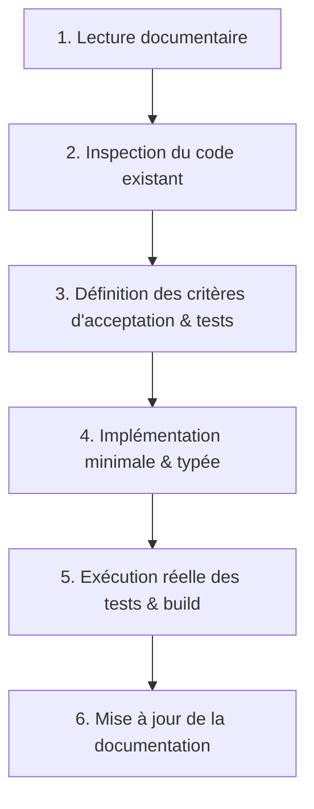

# Instructions permanentes pour les agents IA — QR Studio

> **Version :** 1.0.0  
> **Statut :** Document normatif prioritaire et obligatoire  
> **Cible :** Tout agent IA ou développeur intervenant sur le projet QR Studio  
> **Dernière mise à jour :** 2026-10-27

---

## 1. Résumé du projet et vision d'ingénierie

**QR Studio** est une application web monopage et statique haute performance, conçue pour permettre aux particuliers et professionnels de créer, personnaliser, prévisualiser, sauvegarder localement et exporter des QR codes riches, sans création de compte, gratuitement et avec une garantie absolue de confidentialité : **100 % des traitements s'exécutent côté client dans le navigateur web de l'utilisateur**.

Le modèle économique repose sur l'audience naturelle (SEO) et la monétisation programmatique (ex. Google AdSense ou solution équivalente agréée).

---

## 2. Objectifs et contraintes absolues (Non-négociables)

Toute intervention sur ce dépôt doit se plier aux principes architecturaux intangibles suivants :

1. **Zéro backend applicatif & zéro base de données distante** :
   - Aucun serveur Node/Python/Go/PHP ne doit être créé pour le fonctionnement de l'application métier.
   - Les données saisies par l'utilisateur (URL, mots de passe Wi-Fi, coordonnées vCard, etc.) ne doivent **jamais** transiter sur un réseau.
2. **Génération 100 % locale (Client-Side Only)** :
   - Le moteur de génération QR s'exécute exclusivement via les API Web du navigateur (Canvas, SVG, Web Workers, Blob, URL objet).
   - Pas de recours à des API externes de génération de QR code (ex. Google Chart API, QuickChart, etc.).
3. **Persistance locale et privée** :
   - Les projets sauvegardés sont stockés dans **IndexedDB** (via le wrapper Dexie.js).
   - Les préférences d'interface légères (thème sombre, dernier type de QR sélectionné) peuvent utiliser `localStorage`.
4. **Déploiement statique universel (SSG)** :
   - Le projet est compilé en fichiers statiques purs (`nuxt generate` / `nitro preset`).
   - Compatible avec tout hébergeur statique (Cloudflare Pages, Vercel, Netlify, GitHub Pages, Amazon S3 / CloudFront).
5. **Indépendance stricte du moteur métier vis-à-vis des tiers** :
   - Les scripts tiers (AdSense, Consent Management Platform / CMP, mesure d'audience respectueuse) doivent être isolés dans des modules dédiés et ne doivent en aucun cas bloquer, altérer ou observer le cycle de génération de QR codes.
6. **QR codes 100 % statiques** :
   - Aucun système d'URL courte de redirection sous contrôle de QR Studio. Le contenu encodé est directement la donnée finale.

---

## 3. Socle technique et validation des dépendances

- **Framework d'application** : Nuxt (version 3.x stable ou Nuxt 4 stabilisé avec Nitro).
- **Langage** : TypeScript 5.x avec configuration stricte (`"strict": true`, `"noImplicitAny": true`, `"exactOptionalPropertyTypes": true`).
- **Composants d'interface** : Vue 3 (Composition API avec `<script setup lang="ts">`).
- **Moteur de rendu QR** : `qr-code-styling` (rendu DOM SVG et Canvas).
- **Validation des données et schémas** : `zod` (utilisé pour valider les formulaires et les imports de configurations JSON).
- **Persistance IndexedDB** : `dexie` (version 4.x).
- **Jeu d'icônes** : `lucide-vue-next`.
- **Tests unitaires et d'intégration** : `vitest` + `@vue/test-utils` + `happy-dom`.
- **Tests End-to-End** : `@playwright/test`.
- **Gestion d'état** : Composables Vue 3 (`ref`, `reactive`, `useState`) privilégiés. Pinia est exclu sauf si la complexité des états transversaux le rend formellement indispensable après validation architecturale.

### Règles d'ajout d'une dépendance
Il est **strictement interdit** d'installer une dépendance tierce sans avoir validé :
1. Sa compatibilité complète avec le rendu statique et l'environnement SSR/SSG de Nuxt.
2. L'absence de dépendances natives Node.js incompatibles avec le navigateur.
3. Son impact sur le poids du bundle JavaScript initial (< 150 ko gzippé pour le chunk principal).
4. Sa maintenance active et sa conformité avec les licences libres (MIT, Apache-2.0, BSD-3-Clause).

---

## 4. Conventions d'architecture et de structuration du code

L'organisation des sources dans l'application doit respecter strictement la structure suivante :

```text
app/ (ou racine du projet selon convention Nuxt 3/4)
├── assets/             # Styles globaux (CSS pur ou Tailwind si validé ultérieurement)
├── components/
│   ├── layout/         # En-tête, pied de page, conteneurs génériques
│   ├── editor/         # Panneau de gauche de l'éditeur, onglets de design
│   ├── qr/             # Aperçu interactif du QR code, matrice de rendu, canvas
│   ├── forms/          # Formulaires spécifiques par type de contenu
│   ├── projects/       # Modale/page de gestion des projets locaux
│   └── ads/            # Emplacements publicitaires sécurisés
├── composables/        # Logique d'état réactive (useQrProject, useQrCustomizer, useIndexedDb)
├── services/           # Logique pure TypeScript sans dépendance directe à Vue
│   ├── qr/             # Sérialisation, wrappers de qr-code-styling, moteur de cadre
│   ├── storage/        # Définition des bases Dexie, schémas de migration
│   ├── export/         # Génération des fichiers PNG, SVG, JPEG, WebP et impression
│   └── validation/     # Schémas Zod pour chaque type de contenu
├── types/              # Définitions TypeScript strictes et partagées
│   ├── qr.ts           # Types des designs, modules, dégradés, cadres
│   ├── content.ts      # Types des contenus (URL, Wi-Fi, vCard, etc.)
│   └── project.ts      # Schémas des projets sauvegardés
├── utils/              # Fonctions pures d'aide (formatage, téléchargement blob)
└── pages/              # Routes statiques de l'application
```

### Règles de séparation des responsabilités :
- **Composants (`components/`)** : Exclusivement responsables de l'affichage et de l'interactivité utilisateur. Ils ne doivent pas contenir de logique de sérialisation complexe ni d'appels directs à IndexedDB.
- **Composables (`composables/`)** : Font le pont entre l'état réactif de l'UI et les services métiers.
- **Services (`services/`)** : Modules TypeScript purs, sans état réactif Vue (`no ref/reactive`), facilement testables unitairement hors DOM.

---

## 5. Règles Nuxt et gestion du rendu (SSR vs Client-Only)

1. **Hydratation et composants graphiques** :
   - `qr-code-styling`, Canvas, Web Workers et Dexie/IndexedDB requièrent l'objet global `window` ou `document`.
   - Tout composant manipulant le DOM graphique du QR code ou IndexedDB doit être encapsulé dans un `<ClientOnly>` ou déclenché au sein du hook `onMounted()`.
   - Aucun accès direct à `window`, `document` ou `navigator` dans le corps direct d'un `<script setup>` (hors hooks de cycle de vie client).
2. **Pré-rendu SSG** :
   - Les pages éditoriales (`/`, `/guides/*`, `/about`, `/privacy`, `/legal`) doivent être intégralement pré-rendues statiquement avec leurs métadonnées SEO complètes (`useSeoMeta`, balises canoniques, JSON-LD).
   - L'éditeur `/create` doit afficher un squelette accessible (skeleton loader) lors du rendu SSR avant d'initialiser le moteur interactif côté client.

---

## 6. Règles de sécurité et de confidentialité pour les agents

1. **Protection contre les injections XSS** :
   - Interdiction d'utiliser `v-html` sur du contenu généré à partir de données utilisateur ou de fichiers importés.
   - Si un fichier SVG est téléversé pour servir de logo, il doit être assaini ou dessiné sur un Canvas isolé, jamais injecté directement dans le DOM sous forme de nœuds bruts.
2. **Validation stricte à l'entrée** :
   - Tout fichier JSON de projet importé depuis l'appareil utilisateur doit être rigoureusement validé via le schéma Zod de version correspondant avant d'être injecté dans l'état ou la base IndexedDB.
3. **Absence de fuite réseau** :
   - Vérifier qu'aucune requête HTTP/Fetch sortante ne contient les chaînes encodées dans les QR codes.
   - Les adresses IP et paramètres d'URL ne doivent jamais être corrélés aux contenus créés.

---

## 7. Règles relatives au SEO et à la monétisation publicitaire

1. **Emplacements d'affichage** :
   - Les encarts publicitaires (`<AdSlot>`) doivent être placés de manière non intrusive (bannières latérales, bas de page, entre deux sections de contenu éditorial).
   - **Interdiction formelle** de placer un encart publicitaire entre le bouton d'action principal (Générer / Télécharger) et l'aperçu du QR code, ou de déclencher des redirections intempestives.
2. **Dégradation gracieuse (AdBlockers & Consentement)** :
   - Si l'utilisateur utilise un bloqueur de publicités ou refuse les traceurs, l'application doit fonctionner à 100 % sans bandeau bloquant, sans décalage de layout (CLS maîtrisé grâce à des dimensions d'encart réservées en CSS).
3. **Performance Core Web Vitals** :
   - LCP (Largest Contentful Paint) < 2.0s.
   - CLS (Cumulative Layout Shift) < 0.05.
   - INP (Interaction to Next Paint) < 150ms.

---

## 8. Méthode de travail obligatoire pour tout agent IA

Avant d'écrire ou de modifier une seule ligne de code dans ce dépôt, chaque agent IA doit impérativement exécuter la procédure en 6 étapes :



1. **Étape 1 : Lecture documentaire**  
   Consulter le document d'architecture (`docs/03-architecture-technique.md`), les spécifications fonctionnelles (`docs/02-specifications-fonctionnelles.md`) et la spécification détaillée correspondante dans `docs/features/`.
2. **Étape 2 : Inspection du code existant**  
   Vérifier l'existant, identifier les points de réutilisation possibles, s'assurer de ne pas recréer de doublon.
3. **Étape 3 : Établissement des critères d'acceptation**  
   Formuler les critères en syntaxe standardisée `Étant donné / Lorsque / Alors`. Rédiger les tests unitaires préliminaires (TDD recommandé pour les services de sérialisation et de validation).
4. **Étape 4 : Implémentation**  
   Appliquer le typage strict, respecter la séparation composants/composables/services, documenter le code complexe par des commentaires concis.
5. **Étape 5 : Contrôles réels**  
   - Exécuter la vérification des types (`npx nuxi typecheck` ou `vue-tsc --noEmit`).
   - Exécuter la suite de tests unitaires (`npm run test:unit`).
   - Exécuter le build statique (`npm run generate`).
   - **Règle absolue d'honnêteté :** Ne jamais prétendre qu'un test ou qu'un build est réussi si la commande n'a pas été réellement exécutée et vérifiée avec un code retour à zéro.
6. **Étape 6 : Tenue à jour du référentiel**  
   Mettre à jour le statut dans `docs/13-registre-des-exigences.md` et dans `docs/10-plan-implementation.md`.

---

## 9. Format attendu des comptes rendus de travail d'un agent

Tout compte rendu fourni par un agent IA doit être concis, structuré et contenir impérativement :
- **Tâche traitée** (ex. `QR-004 : Formulaires des types de contenu`).
- **Fichiers créés ou modifiés** (avec liens Markdown clairs).
- **Décisions de conception prises** et respect des ADRs.
- **Résultats des vérifications exécutées** (commandes lancées, temps d'exécution, statuts passants).
- **Problèmes résiduels ou points de vigilance** nécessitant une attention humaine.
