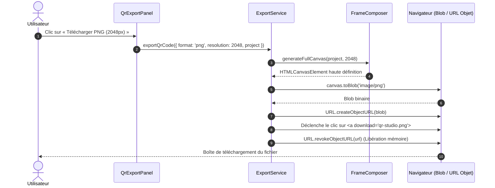

# Architecture Technique — QR Studio

> **Version :** 1.0.0  
> **Statut :** À valider  
> **Rôle :** Spécification de l'architecture logicielle, flux de données et choix de conception  
> **Date :** 2026-10-27

---

## 1. Vue d'ensemble de l'architecture

QR Studio repose sur une architecture **100 % statique et sans état distant (Jamstack / Pure Client-Side Application)** construite avec le framework **Nuxt** en mode SSG (Static Site Generation).

Toutes les capacités métier (sérialisation des contenus, rendu graphique vectoriel/matriciel, incrustation de logo, composition de cadre, persistance des projets et export binaire) sont hébergées et exécutées **dans le moteur d'exécution JavaScript du navigateur de l'utilisateur final**.

```mermaid
graph TD
    subgraph Client Browser [Navigateur Client - 100% Hors Ligne]
        subgraph UI [Couche Présentation Vue 3]
            Pages[Pages Nuxt : /create, /projects, /guides]
            CompEditor[Composants Editeur : Panneau Gauche & Droite]
            CompPreview[Composant Aperçu QR interactif]
        end

        subgraph State [Couche Réactivité & Composables]
            useProject[useQrProject - État du projet actif]
            useCustomizer[useQrCustomizer - Paramètres de style]
            useStorage[useLocalProjects - Gestion CRUD projets]
        end

        subgraph Services [Couche Métier Pure TypeScript]
            Serializers[Services de Sérialisation : vCard, Wi-Fi, URL...]
            Validators[Validateurs Schémas Zod]
            EngineWrapper[Wrapper qr-code-styling]
            FrameEngine[Moteur de composition de Cadres & Textes]
            ExportService[Service d'Export : SVG, PNG, JPEG, WebP]
            DexieDB[(IndexedDB - Base Locale Dexie)]
        end
    end

    subgraph StaticHost [Hébergeur Statique / CDN]
        HTML[Fichiers HTML pré-rendus SSG]
        Assets[Bundles JS / CSS statiques]
    end

    UI --> State
    State --> Services
    Services --> DexieDB
    StaticHost -.->|Téléchargement initial du bundle| Client Browser
```

---

## 2. Découpage en couches et responsabilités

L'application respecte une séparation stricte des responsabilités en 4 couches concentriques :

```text
┌─────────────────────────────────────────────────────────┐
│ 1. Couche Présentation (Vue Components & Layouts)        │
│    - Rendu du DOM, accessibilité, interactions boutons  │
└──────────────────────────┬──────────────────────────────┘
                           │
┌──────────────────────────▼──────────────────────────────┐
│ 2. Couche État Réactif (Vue Composables)                │
│    - Orchestration de la réactivité, hooks de cycle      │
└──────────────────────────┬──────────────────────────────┘
                           │
┌──────────────────────────▼──────────────────────────────┐
│ 3. Couche Métier Pure (Services TypeScript purs)         │
│    - Sérialisation des données, validation Zod          │
│    - Composition graphique Canvas / SVG                 │
└──────────────────────────┬──────────────────────────────┘
                           │
┌──────────────────────────▼──────────────────────────────┐
│ 4. Couche Stockage & Moteur Bas Niveau                  │
│    - Dexie.js (IndexedDB) & Moteur qr-code-styling      │
└─────────────────────────────────────────────────────────┘
```

### 2.1. Couche Présentation (`components/`, `pages/`)
- Contient les composants Vue 3 utilisant exclusivement `<script setup lang="ts">`.
- Ne contient **aucune logique métier complexe** (pas de manipulation directe de bits, pas d'assemblage vCard brut).
- Encapsule les parties graphiques dépendantes du DOM dans `<ClientOnly>` afin de garantir un pré-rendu SSG sans erreur d'hydratation.

### 2.2. Couche Réactivité & État (`composables/`)
- Maintient l'état réactif courant via `ref()` et `computed()`.
- Fournit des méthodes d'action claires consommables par les composants (`updateDesign()`, `changeContentType()`, `saveCurrentProject()`).
- Déclenche les calculs de prévisualisation avec un **debounce** (100 à 150 ms) pour garantir une frappe fluide sans gel de l'UI.

### 2.3. Couche Services Métiers (`services/`)
- Écrite en **TypeScript pur**, sans import de `vue` (aucun `ref`, `reactive`, ni hooks de cycle de vie).
- Directement exécutable et testable unitairement via Vitest en environnement Node/CLI ou navigateur.
- Comprend :
  - `services/qr/serializers/` : 10 fonctions pures de sérialisation transformant un objet typé en chaîne encodable conforme aux RFC et standards.
  - `services/validation/` : Schémas Zod pour chaque type de contenu et pour le format de projet global.
  - `services/qr/qr-engine.service.ts` : Façade isolant la dépendance `qr-code-styling`.
  - `services/qr/frame-composer.service.ts` : Service dessinant le cadre décoratif et le call-to-action autour de la matrice QR.
  - `services/export/export.service.ts` : Génération des blobs téléchargeables (SVG, PNG, JPEG, WebP) et gestion du flux d'impression.
  - `services/storage/db.service.ts` : Définition des tables Dexie et des migrations.

### 2.4. Types partagés (`types/`)
- Source unique des définitions d'interfaces, types unions et enums TypeScript pour tout le projet.

---

## 3. Structure détaillée des répertoires

```text
qr-studio/
├── app.vue                         # Composant racine Nuxt
├── nuxt.config.ts                  # Configuration Nuxt (modules, SSG, nitro)
├── tsconfig.json                   # Configuration TypeScript stricte
├── package.json
├── assets/
│   └── css/
│       ├── main.css                # Styles globaux, variables CSS, polices
│       └── print.css               # Feuille de style dédiée à l'impression
├── public/
│   ├── favicon.ico
│   ├── robots.txt
│   └── sitemap.xml
├── pages/
│   ├── index.vue                   # Page d'accueil vitrine & CTA
│   ├── create.vue                  # Application principale : Éditeur QR Studio
│   ├── projects.vue                # Gestionnaire des projets locaux
│   ├── about.vue                   # Page À propos & Mission
│   ├── privacy.vue                 # Politique de confidentialité (garantie locale)
│   ├── legal.vue                   # Mentions légales
│   ├── contact.vue                 # Informations de contact
│   └── guides/
│       ├── index.vue               # Hub central des guides
│       ├── qr-code-url.vue         # Guide spécifique URL
│       ├── qr-code-wifi.vue        # Guide spécifique Wi-Fi
│       ├── qr-code-contact.vue     # Guide spécifique vCard
│       └── qr-code-menu.vue        # Guide spécifique Restaurant
├── components/
│   ├── layout/
│   │   ├── AppHeader.vue
│   │   ├── AppFooter.vue
│   │   └── Container.vue
│   ├── editor/
│   │   ├── QrTypeSelector.vue
│   │   ├── QrContentForm.vue
│   │   ├── QrDesignTabs.vue
│   │   ├── QrColorEditor.vue
│   │   ├── QrShapeEditor.vue
│   │   ├── QrLogoEditor.vue
│   │   ├── QrFrameEditor.vue
│   │   └── QrAdvancedSettings.vue
│   ├── qr/
│   │   ├── QrPreview.vue
│   │   └── QrExportPanel.vue
│   ├── forms/
│   │   ├── FormUrl.vue
│   │   ├── FormText.vue
│   │   ├── FormWifi.vue
│   │   ├── FormVCard.vue
│   │   ├── FormEmail.vue
│   │   ├── FormSms.vue
│   │   ├── FormPhone.vue
│   │   ├── FormGeo.vue
│   │   ├── FormEvent.vue
│   │   └── FormCustom.vue
│   ├── projects/
│   │   ├── ProjectCard.vue
│   │   └── ProjectEmptyState.vue
│   └── ads/
│       └── AdSlot.vue              # Encart publicitaire encapsulé avec slot fallback
├── composables/
│   ├── useQrProject.ts             # Gestion de l'état du QR code courant
│   ├── useQrCustomizer.ts          # Gestion fine des paramètres de styles
│   ├── useLocalProjects.ts         # Actions IndexedDB (lister, charger, supprimer)
│   └── useDebounce.ts              # Utilitaire de debounce réactif
├── services/
│   ├── qr/
│   │   ├── qr-engine.service.ts
│   │   ├── frame-composer.service.ts
│   │   └── serializers/
│   │       ├── url.serializer.ts
│   │       ├── wifi.serializer.ts
│   │       ├── vcard.serializer.ts
│   │       ├── email.serializer.ts
│   │       ├── sms.serializer.ts
│   │       ├── phone.serializer.ts
│   │       ├── geo.serializer.ts
│   │       ├── event.serializer.ts
│   │       └── text.serializer.ts
│   ├── export/
│   │   ├── export.service.ts
│   │   └── print.service.ts
│   ├── storage/
│   │   ├── db.service.ts           # Schéma Dexie
│   │   └── project-storage.service.ts
│   └── validation/
│       ├── content.schema.ts
│       ├── design.schema.ts
│       └── project.schema.ts
└── types/
    ├── content.ts
    ├── design.ts
    ├── project.ts
    └── export.ts
```

---

## 4. Diagrammes des flux principaux

### 4.1. Flux de génération et mise à jour de la prévisualisation

Ce flux décrit le parcours réactif entre la saisie de l'utilisateur et le rendu visuel dans le navigateur.

```mermaid
sequenceDiagram
    autonumber
    actor User as Utilisateur
    participant Form as Composant QrContentForm
    participant Composable as useQrProject
    participant Serializer as Serializer Métier
    participant Engine as qr-code-styling Facade
    participant Frame as FrameComposer
    participant DOM as Canvas / SVG DOM

    User->>Form: Modifie un champ (ex. SSID Wi-Fi)
    Form->>Composable: Émet l'événement de mise à jour
    Note over Composable: Déclenchement d'un debounce (100 ms)
    Composable->>Serializer: serializeContent(type, data)
    Serializer-->>Composable: Chaîne brute (WIFI:S:MySSID;T:WPA;P:secret;;)
    Composable->>Engine: update({ data, designOptions })
    Engine->>DOM: Rend la matrice QR de base (offscreen ou SVG)
    Composable->>Frame: renderWithFrame(qrElement, frameOptions)
    Frame->>DOM: Dessine le cadre décoratif + texte d'appel à l'action
    DOM-->>User: Aperçu mis à jour à l'écran (< 100 ms)
```

---

### 4.2. Flux d'export binaire (PNG / SVG / JPEG / WebP)



---

## 5. Gestion des contraintes SSR et génération statique (SSG)

Le projet Nuxt est configuré en mode **Static Site Generation** (`target: 'static'` / Nitro preset pour hébergeur statique).

### Règle d'or de l'environnement :
1. `window`, `document`, `navigator`, `indexedDB`, `HTMLCanvasElement` et `qr-code-styling` **n'existent pas** lors de la compilation statique (Node.js).
2. Pour prévenir toute erreur `ReferenceError: window is not defined` :
   - Tous les modules utilisant `qr-code-styling` ou `Dexie` sont initialisés dynamiquement ou dans des composables exécutés côté client.
   - Les composants graphiques d'aperçu sont enveloppés dans des balises `<ClientOnly>` avec un affichage de secours (squelette de chargement accessible) :

```vue
<!-- Exemple de pattern architectural standard dans l'application -->
<template>
  <div class="qr-preview-container">
    <ClientOnly>
      <QrPreviewCanvas :project="currentProject" />
      <template #fallback>
        <div class="qr-preview-skeleton" aria-label="Chargement de l'aperçu..." />
      </template>
    </ClientOnly>
  </div>
</template>
```

---

## 6. Gestion de la mémoire et cycle de vie des ressources locales

L'application traite des fichiers images (logos téléversés par l'utilisateur) et des rendus Canvas haute définition. Pour éliminer les fuites de mémoire (*memory leaks*) :
1. **Révocation systématique des URLs d'objets** :  
   Tout appel à `URL.createObjectURL(blob)` doit impérativement avoir son pendant `URL.revokeObjectURL(url)` dès que l'image est chargée en mémoire ou dès que le composant est démonté (`onUnmounted`).
2. **Gestion des logos dans IndexedDB** :  
   - Les logos sont conservés sous forme de `Blob` binaire dans la table Dexie des projets.
   - Lors du chargement d'un projet, une URL d'objet est créée temporairement pour l'affichage réactif et libérée dès la suppression ou le changement de logo.
3. **Dimensions maximales maîtrisées** :  
   - Les fichiers logos sont limités à 2 Mo et redimensionnés localement via Canvas s'ils dépassent 1024×1024 px avant encodage, afin de ne pas saturer l'espace IndexedDB.

---

## 7. Gestion de l'état de l'application

Le projet privilégie délibérément les **Composables Vue 3 natifs** plutôt que l'ajout systématique d'une dépendance lourde comme Pinia :
- `useQrProject` : état unitaire du projet en cours d'édition (type, données, options de style, état de saleté `isDirty`).
- `useLocalProjects` : état de la liste des projets sauvegardés, chargement asynchrone depuis IndexedDB et pagination.
- `usePreferences` : préférences d'interface (thème sombre, zoom de prévisualisation) persistées simplement dans `localStorage`.

Si et seulement si la complexité des états transversaux devenait ingérable au cours de développements ultérieurs, l'introduction de Pinia fera l'objet d'un ADR dédié. Pour la v1.0, les composables réactifs purs couvrent 100 % des besoins avec une empreinte bundle minimale.
