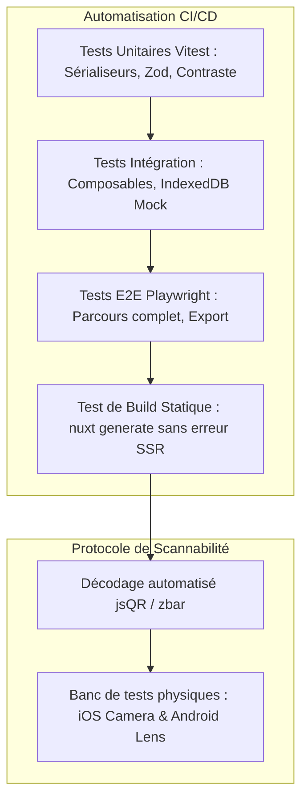

# Stratégie de Tests et Critères d'Acceptation — QR Studio

> **Version :** 1.0.0  
> **Statut :** À valider  
> **Rôle :** Stratégie d'assurance qualité, matrice de tests et critères de scannabilité  
> **Date :** 2026-10-27

---

## 1. Philosophie d'assurance qualité et règle d'or

Dans une application de génération de QR codes :
> **« La simple production d'un fichier image ou d'un SVG ne prouve en aucun cas que le QR code est valide. Un QR code n'est réussi que s'il peut être décodé de manière fiable et rapide par un appareil réel. »**

L'assurance qualité de QR Studio combine des tests automatisés logiciels (unitaires, intégration, E2E) et un protocole strict de validation physique de scannabilité.



---

## 2. Niveaux de tests automatisés

---

### 2.1. Tests Unitaires (`Vitest`)
- **Exécution :** Instantanée en environnement Node / Happy-DOM via `npm run test:unit`.
- **Périmètre couvert :**
  1. **Sérialiseurs (`services/qr/serializers/`) :**
     - Vérification de la conformité RFC 2426 (vCard), MECARD, iCalendar et syntaxe Wi-Fi (`WIFI:S:SSID;T:WPA;P:pass;;`).
     - Test des caractères d'échappement (points-virgules, barres obliques inverses, deux-points).
  2. **Schémas de validation (`services/validation/`) :**
     - Rejet des URLs malformées (sans protocole, avec espaces).
     - Bornes de coordonnées GPS (latitude hors `[-90, 90]`, longitude hors `[-180, 180]`).
     - Validation de cohérence des dates d'événements (`endDate` antérieure à `startDate`).
  3. **Calculateur de contraste de couleur :**
     - Formule de luminance relative (norme WCAG).
     - Alerte automatique lorsque le contraste entre la couleur des modules et l'arrière-plan est inférieur à 4:1.

---

### 2.2. Tests d'Intégration du Stockage Local
- **Outil :** Vitest + `fake-indexeddb`.
- **Périmètre :**
  - Opérations CRUD dans la base Dexie (`create`, `read`, `update`, `delete`).
  - Persistance et restauration correcte des objets `Blob` (logos).
  - Gestion des migrations de schémas (passage de `schemaVersion: 1` à une version ultérieure).
  - Comportement en cas de dépassement de quota (`QuotaExceededError`).

---

### 2.3. Tests End-to-End (`Playwright`)
- **Exécution :** Navigateurs réels headless (Chromium, Firefox, WebKit) via `npm run test:e2e`.
- **Scénarios critiques automatisés :**
  1. *Scénario 1 (Création et export PNG) :* Saisie d'une URL -> Modification de la couleur -> Clic sur « Télécharger PNG » -> Vérification de la présence et de la taille du fichier téléchargé.
  2. *Scénario 2 (Wi-Fi et sauvegarde locale) :* Remplissage formulaire Wi-Fi -> Clic sur « Enregistrer le projet » -> Navigation vers `/projects` -> Vérification que la carte du projet est présente avec la vignette miniature.
  3. *Scénario 3 (Import JSON corrompu) :* Tentative d'import d'un fichier JSON non conforme -> Affichage du message d'erreur sans crash de l'interface.
  4. *Scénario 4 (Responsive Mobile) :* Test d'interaction sur un viewport smartphone (375×667 px) -> Vérification que la barre d'action inférieure est cliquable et accessible.

---

### 2.4. Tests de Rendu et de Compilation Statique (SSG)
- **Commande :** `npm run generate`.
- **Validation :**
  - Aucune erreur `window is not defined` ou `document is not defined` pendant la phase de pré-rendu de toutes les routes de l'application.
  - Présence physique des fichiers HTML générés dans `.output/public/` pour toutes les routes (accueil, éditeur, guides).

---

## 3. Matrice des cas limites et cas d'erreur testés

| Cas de test | Entrée fournie | Comportement attendu |
| :--- | :--- | :--- |
| **Contenu vide** | Chaîne vide `""` | Message d'erreur sous le champ, le bouton d'export est désactivé. |
| **Texte très long** | 3000 caractères | Le niveau de version de la matrice QR s'adapte automatiquement, avertissement sur la petite taille des modules. |
| **URL sans protocole** | `mon-site.fr` | Validation Zod : ajout automatique de `https://` ou invite explicite de correction. |
| **Wi-Fi sans mot de passe** | Chiffrement `nopass` | Le champ mot de passe est masqué/désactivé, la chaîne encodée omet le segment `P:`. |
| **Caractères spéciaux Wi-Fi** | SSID : `M@_Box;5G\Test` | Échappement rigoureux (`M@_Box\;5G\\Test`) pour éviter la rupture du protocole Wi-Fi standard. |
| **Contact vCard partiel** | Prénom seul, pas d'adresse | Génération d'une vCard valide omettant proprement les champs non renseignés. |
| **Date d'événement incohérente** | Fin antérieure au début | Erreur de validation en ligne immédiate, refus d'encodage. |
| **GPS hors limites** | Lat = 95.0, Lon = 200.0 | Blocage immédiat avec message d'erreur explicite. |
| **Logo trop volumineux** | Fichier image de 8 Mo | Rejet immédiat côté client avec toast *« Taille maximale de logo : 2 Mo »*. |
| **Fichier JSON corrompu** | Syntaxe JSON invalide | Alerte utilisateur, aucun état corrompu injecté dans l'éditeur. |
| **Projet ancien schéma** | `schemaVersion: 0` ou manquant | Application des valeurs par défaut pour les nouveaux champs (cadre, options). |
| **Bloqueur de pub (AdBlock)** | Script AdSense bloqué | L'application fonctionne sans bandeau bloquant, aucun message agressif. |

---

## 4. Protocole de Scannabilité et Validation Physique

Pour chaque modèle de cadre, combinaison de formes de points et incrustation de logo :

### 4.1. Décodage automatisé (CI)
Avant validation d'un nouveau style graphique, le canvas généré est transmis à la bibliothèque de décodage `jsQR` :
- Le contenu décodé doit correspondre **au caractère près** à la chaîne source encodée.

### 4.2. Banc d'essai physique multi-appareils
Un QR code personnalisé doit être validé avec succès sur les appareils réels suivants :
1. **Apple iPhone (iOS Récent)** : Application Appareil Photo native (détection à distance de lecture standard).
2. **Android (Google Pixel / Samsung Galaxy)** : Application Appareil Photo native et Google Lens.
3. **Conditions d'éclairage variées** :
   - Éclairage direct (bureau).
   - Éclairage tamisé (simulation ambiance restaurant / bar).
   - Affichage sur écran LCD et impression physique sur papier mat 80g standard.

---

## 5. Critères d'acceptation formalisés (Syntaxe Gherkin)

```gherkin
Fonctionnalité: Incrustation d'un logo et préservation de la scannabilité
  En tant qu'utilisateur de QR Studio
  Je veux intégrer mon logo de marque au centre de mon QR code
  Afin que mes clients reconnaissent immédiatement mon identité

  Scénario: Ajustement automatique de la correction d'erreur lors de l'ajout d'un logo
    Étant donné un QR code configuré avec un niveau d'erreur "L" (7 %)
    Lorsque l'utilisateur téléverse un fichier logo "logo.png" de 200 Ko
    Alors le logo apparaît au centre de l'aperçu
    Et le niveau de correction d'erreur est automatiquement ajusté à "Q" (25 %)
    Et une mention informative indique que la redondance a été augmentée pour garantir la lisibilité
    Et le QR code résultant reste scannable par le décodeur de test
```
