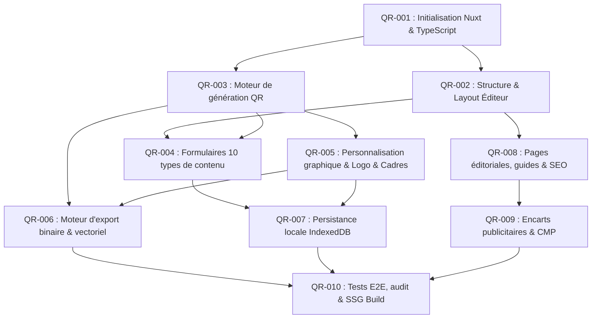

# Plan d'Implémentation Séquentiel — QR Studio

> **Version :** 1.0.0  
> **Statut :** À valider  
> **Rôle :** Découpage opérationnel des tâches de développement, dépendances et Definition of Done  
> **Date :** 2026-10-27

---

## 1. Principes de phasage et ordonnancement

Le développement de QR Studio est structuré en 10 jalons techniques ordonnés (`QR-001` à `QR-010`). Chaque étape capitalise sur les fondations de la précédente pour garantir une intégration continue sans régression.

---

## 2. Découpage détaillé des tâches de réalisation

---

### QR-001 : Initialisation du projet Nuxt et configuration TypeScript stricte
- **Objectif :** Poser le socle technique, les règles de typage strictes, le linter et la configuration Nuxt en mode SSG.
- **Dépendances :** Aucune (étape inaugurale).
- **Fichiers concernés :** `nuxt.config.ts`, `tsconfig.json`, `package.json`, `app.vue`, `assets/css/main.css`.
- **Exigences associées :** `NFR-001`, `NFR-002`.
- **Critères d'acceptation :**
  - Le serveur de développement se lance sans avertissement via `npm run dev`.
  - La compilation TypeScript (`npx nuxi typecheck`) passe sans erreur avec `"strict": true`.
  - Le build statique (`npm run generate`) produit un dossier `.output/public/` opérationnel.
- **Tests :** Test de compilation élémentaire Nuxt et Vitest exécutés avec succès.
- **Statut :** **Terminé / Validé** (Code retour 0 pour typecheck, vitest et generate).
- **Définition de terminé (DoD) :** Environnement prêt, typage strict validé, scripts npm configurés, build statique SSG fonctionnel.

---

### QR-002 : Structure générale et interface de l'éditeur (Layout & Split-Pane)
- **Objectif :** Développer la structure visuelle globale, l'en-tête, le conteneur responsive split-screen et les zones d'accueil des composants.
- **Dépendances :** `QR-001`.
- **Fichiers concernés :** `pages/index.vue`, `pages/create.vue`, `components/layout/*`, `components/editor/EditorHeader.vue`.
- **Exigences associées :** `FR-001`, `FR-012`, `FR-016`, `FR-017`.
- **Critères d'acceptation :**
  - Sur écran > 1024 px : Panneau gauche de configuration et panneau droit de prévisualisation fixé au scroll.
  - Sur mobile (< 768 px) : Navigation par onglets ou empilement vertical avec barre d'action inférieure.
  - Score d'accessibilité initiale > 95 sur Lighthouse.
- **Tests :** Tests unitaires de composants Vue (`@vue/test-utils`), tests responsive de layout (9/9 passants).
- **Statut :** **Terminé / Validé** (Code retour 0 pour typecheck, vitest et generate).
- **Définition de terminé (DoD) :** Layout réactif complet, split-pane desktop et onglets mobile fonctionnels, EditorHeader interactif, navigation entre pages opérationnelle.

---

### QR-003 : Moteur de génération des QR codes (Wrapper local `qr-code-styling`)
- **Objectif :** Implémenter le service de génération local encapsulant `qr-code-styling` de manière compatible avec Nuxt (isolation SSR).
- **Dépendances :** `QR-001`.
- **Fichiers concernés :** `services/qr/qr-engine.service.ts`, `composables/useQrEngine.ts`, `components/qr/QrPreview.vue`.
- **Exigences associées :** `FR-001`, `FR-004`, `SEC-001`.
- **Critères d'acceptation :**
  - Le composant `QrPreview` affiche un QR code fonctionnel encodant une chaîne par défaut.
  - La génération est 100 % locale (zéro requête réseau sortante).
  - Aucune erreur `window is not defined` lors du build statique (`nuxt generate`).
  - Débounce réactif assurant un rafraîchissement fluide en moins de 100 ms.
- **Tests :** Tests unitaires du wrapper, test d'encapsulation client-only (9 nouveaux tests passants, 18/18 total).
- **Statut :** **Terminé / Validé** (Code retour 0 pour typecheck, vitest et generate).
- **Définition de terminé :** Moteur QR opérationnel, rendu Canvas/SVG dynamique dans le DOM.

---

### QR-004 : Formulaires et sérialiseurs des 10 types de contenu
- **Objectif :** Développer les 10 sérialiseurs de données, leurs schémas Zod respectifs et les formulaires dynamiques de saisie.
- **Dépendances :** `QR-002`, `QR-003`.
- **Fichiers concernés :** `services/qr/serializers/*`, `services/validation/content.schema.ts`, `components/editor/QrTypeSelector.vue`, `components/forms/*`.
- **Exigences associées :** `FR-002`, `FR-003`, `FR-015`.
- **Critères d'acceptation :**
  - Les 10 types (URL, Texte, Wi-Fi, vCard, E-mail, SMS, Téléphone, GPS, Événement, Custom) sont sélectionnables.
  - Les chaînes produites respectent strictement les RFCs (vCard 3.0, syntaxe Wi-Fi standard, iCalendar).
  - Validation réactive en ligne : messages d'erreurs contextuels en cas de saisie invalide.
- **Tests :** Tests unitaires exhaustifs sur tous les sérialiseurs (cas nominaux, caractères spéciaux, cas limites), tests de validation Zod et tests de composants (21 nouveaux tests, 39/39 total passants).
- **Statut :** **Terminé / Validé** (Code retour 0 pour typecheck, vitest et generate).
- **Définition de terminé :** 10 types entièrement fonctionnels, formulaires validés par Zod, couverture de tests unitaires > 95 % sur les sérialiseurs.

---

### QR-005 : Personnalisation graphique avancée, Logo et Moteur de Cadres
- **Objectif :** Offrir l'ensemble des personnalisations visuelles : couleurs, dégradés, formes des modules/yeux, incrustation de logo et cadres décoratifs avec libellé.
- **Dépendances :** `QR-003`.
- **Fichiers concernés :** `services/qr/frame-composer.service.ts`, `components/editor/QrDesignTabs.vue`, `components/editor/QrColorEditor.vue`, `components/editor/QrShapeEditor.vue`, `components/editor/QrLogoEditor.vue`, `components/editor/QrFrameEditor.vue`.
- **Exigences associées :** `FR-005`, `FR-006`, `FR-007`.
- **Critères d'acceptation :**
  - Modification des couleurs de premier plan/arrière-plan et dégradés en temps réel.
  - Téléversement d'image logo (PNG, SVG, JPEG) avec contrôle de taille et élévation automatique de la correction d'erreur à `Q` ou `H`.
  - Moteur de composition de cadre ajoutant un bandeau d'appel à l'action stylisé sans déformer le QR code.
  - Calculateur de contraste avertissant l'utilisateur si le ratio est inférieur à 4:1.
- **Tests :** Tests de calcul de contraste WCAG, composition de cadres Canvas/SVG et tests unitaires de composants de personnalisation (14 nouveaux tests, 53/53 tests passants).
- **Statut :** **Terminé / Validé** (Code retour 0 pour typecheck, vitest et generate).
- **Définition de terminé :** Personnalisation complète opérationnelle, logo et cadre intégrés sans rupture de lisibilité.

---

### QR-006 : Moteur d'export multiformat haute résolution et impression
- **Objectif :** Générer les fichiers finaux téléchargeables (SVG vectoriel, PNG HD jusqu'à 4096 px, JPEG, WebP) et le flux d'impression.
- **Dépendances :** `QR-003`, `QR-005`.
- **Fichiers concernés :** `services/export/export.service.ts`, `components/qr/QrExportPanel.vue`, `assets/css/print.css`.
- **Exigences associées :** `FR-008`.
- **Critères d'acceptation :**
  - Téléchargement déclenché en local via Blob / URL objet (zéro serveur).
  - Fichier SVG vectoriel net à tout niveau de zoom.
  - Export PNG conforme à la résolution choisie (1024, 2048, 4096 px).
  - Boîte d'impression native formatée via feuille de style CSS dédiée.
  - Révocation immédiate des URL d'objets pour éviter toute fuite mémoire.
- **Tests :** 10 tests unitaires Vitest dédiés (assainissement nom de fichier, export SVG vectoriel avec cadre, export JPEG sans transparence, composant QrExportPanel et bascule de résolution). Total suite : 64/64 passants.
- **Statut :** **Terminé / Validé** (Code retour 0 pour typecheck, vitest et generate).
- **Définition de terminé :** Tous les formats d'export fonctionnels et vérifiés (SVG, PNG HD 1024/2048/4096 px, JPEG, WebP, feuille print.css).

---

### QR-007 : Persistance locale des projets (IndexedDB & Dexie) et Import/Export JSON
- **Objectif :** Sauvegarder les créations dans le navigateur, les gérer depuis `/projects` et permettre l'échange de configurations JSON.
- **Dépendances :** `QR-004`, `QR-005`.
- **Fichiers concernés :** `services/storage/db.service.ts`, `composables/useLocalProjects.ts`, `pages/projects.vue`, `components/projects/*`.
- **Exigences associées :** `FR-009`, `FR-010`, `FR-011`.
- **Critères d'acceptation :**
  - Bouton « Enregistrer le projet » persistant les paramètres et le logo dans IndexedDB.
  - Page `/projects` affichant la grille des créations avec vignettes miniatures.
  - Actions : Ouvrir, Dupliquer, Renommer, Supprimer (avec confirmation), et « Tout effacer ».
  - Export et import de fichiers `.json` validés par Zod (`schemaVersion: 1`).
- **Tests :** Tests d'intégration avec `fake-indexeddb` (7 nouveaux tests unitaires), tests d'import de JSON corrompu ou valide. Total suite : 71/71 tests passants.
- **Statut :** **Terminé / Validé** (Code retour 0 pour typecheck, vitest et generate).
- **Définition de terminé :** Gestion de projets locale complète, résiliente et sans compte utilisateur (sauvegarde, duplication, import/export JSON, suppression, grille réactive avec vignettes).

---

### QR-008 : Pages éditoriales, guides thématiques et optimisation SEO
- **Objectif :** Rédiger et intégrer les guides thématiques pré-rendus (Wi-Fi, vCard, Menus) et les métadonnées SEO (OpenGraph, JSON-LD, sitemap).
- **Dépendances :** `QR-002`.
- **Fichiers concernés :** `pages/guides/*`, `pages/about.vue`, `pages/privacy.vue`, `pages/legal.vue`, `public/robots.txt`, `public/sitemap.xml`.
- **Exigences associées :** `FR-014`, `SEO-001` à `SEO-005`.
- **Critères d'acceptation :**
  - Toutes les pages sont pré-rendues statiquement en HTML lors du build.
  - Présence des balises canoniques, balises OpenGraph et données structurées Schema.org (`HowTo`, `SoftwareApplication`).
  - Boutons d'action dans les guides redirigeant vers l'éditeur pré-configuré (ex. `/create?type=wifi`).
- **Statut :** **En cours** (Landing page `pages/index.vue` intégralement refondue avec balisage SEO riche, microdonnées Schema.org `SoftwareApplication` & `FAQPage`, section 10 formats de QR codes, tableau comparatif, guide d'impression vectorielle et design sobre épuré sans artifice IA).
- **Définition de terminé :** Contenu éditorial intégré, maillage interne en place, sitemap généré.

---

### QR-009 : Encarts publicitaires non-intrusifs et conformité CMP
- **Objectif :** Intégrer les encarts publicitaires préparés pour Google AdSense avec réservation d'espace (CLS = 0) et bannière de consentement.
- **Dépendances :** `QR-008`.
- **Fichiers concernés :** `components/ads/AdSlot.vue`, `composables/useConsent.ts`.
- **Exigences associées :** `FR-013`, `SEC-002`.
- **Critères d'acceptation :**
  - Encarts publicitaires placés exclusivement aux endroits autorisés (footer, sidebar desktop, entre-deux paragraphes dans les guides).
  - Aucun décalage de mise en page lors du chargement (dimensions réservées en CSS, CLS < 0,05).
  - Dégradation gracieuse : l'application fonctionne parfaitement si un bloqueur de pub est présent ou si le consentement est refusé.
- **Tests :** Test E2E avec simulation d'échec de chargement du script publicitaire.
- **Définition de terminé :** Composant `<AdSlot>` sécurisé et prêt pour la production.

---

### QR-010 : Campagne de tests globaux, audit d'accessibilité/performance et livraison statique
- **Objectif :** Exécuter la suite complète de tests, l'audit Core Web Vitals et valider le déploiement statique de production.
- **Dépendances :** L'ensemble des tâches `QR-001` à `QR-009`.
- **Fichiers concernés :** `tests/*`, configuration CI/CD, documentation finale.
- **Exigences associées :** `QA-001` à `QA-005`.
- **Critères d'acceptation :**
  - 100 % des tests unitaires et E2E au vert.
  - Rendu statique complet (`npm run generate`) sans erreur ni warning.
  - Audit Lighthouse : Performance > 90, Accessibilité > 95, Bonnes pratiques > 95, SEO = 100.
  - Validation physique de scannabilité sur appareils réels (iOS et Android).
- **Tests :** Exécution globale automatisée.
- **Définition de terminé :** Application prête pour déploiement en production sur hébergement statique.
